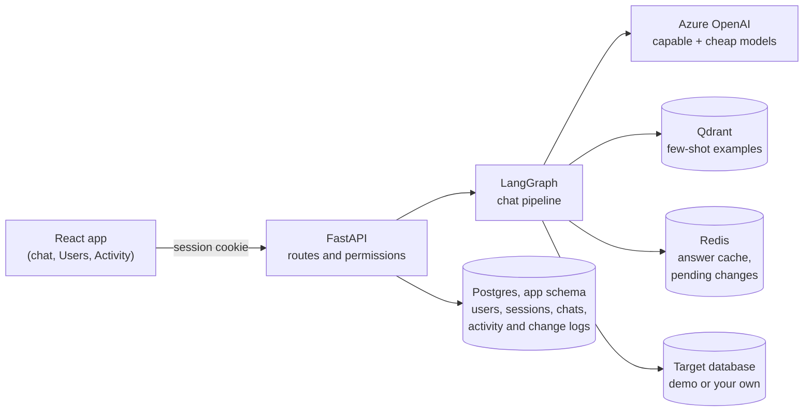
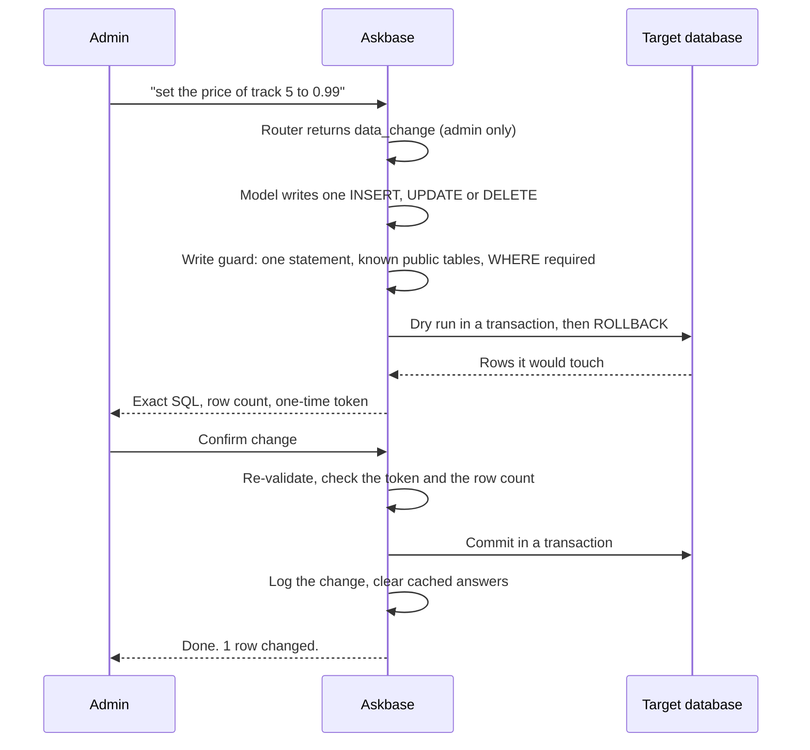

<div align="center">

# Askbase

**Chat with your database.** Ask a question in plain language and get an answer, with the SQL and the result table one click away.


</div>

Askbase turns each question into a safe, read-only SQL query, runs it, and answers in plain language. A demo database (Chinook) is included, and supervisors and admins can connect their own, on PostgreSQL, MySQL, SQL Server, Snowflake and more. Accounts have roles, admins get an activity dashboard, and any data change goes through a preview and an explicit confirmation.

## Contents

- [Features](#features)
- [Tech stack](#tech-stack)
- [How it works](#how-it-works)
  - [Architecture](#architecture)
  - [The chat pipeline](#the-chat-pipeline)
  - [What each step does](#what-each-step-does)
  - [Admin data changes](#admin-data-changes)
  - [Response shapes](#response-shapes)
- [Getting started](#getting-started)
- [Connecting your own database](#connecting-your-own-database)
- [Configuration](#configuration)
- [Hybrid models](#hybrid-models)
- [Accounts, roles and security](#accounts-roles-and-security)
  - [Roles](#roles)
  - [Activity log and dashboard](#activity-log-and-dashboard)
- [Conversations](#conversations)
- [API](#api)
- [Answer cache](#answer-cache)
- [Few-shot examples](#few-shot-examples)
- [Project structure](#project-structure)
- [Troubleshooting](#troubleshooting)

## Features

| | |
|---|---|
| **Chat** | Plain-language questions in, plain-language answers out, with follow-ups that remember the last few exchanges. A results table you can sort, copy, export to CSV, and (for a label plus a number) view as a bar chart. Staged progress while a question runs, regenerate, edit your last question, and one-click follow-up suggestions. |
| **Conversations** | Many chats per user, grouped by day, renamed or deleted from the sidebar. New chats are named automatically by a small language model. |
| **Accounts and roles** | Sign up and log in. Three roles (user, supervisor, admin) with their own privileges. Every user has their own history and connected database. |
| **Your database** | Connect your own SQL database from a guided page (supervisors and admins): pick PostgreSQL, MySQL/MariaDB, SQL Server, Snowflake, BigQuery or ClickHouse, or paste a SQLAlchemy URL for any other engine, and test it before switching. Credentials are stored encrypted. Install the driver for the engine you use (`pymysql`, `pyodbc`, ...). Data changes through chat stay PostgreSQL-only. |
| **Admin tools** | A Users page (accounts, roles, read-only access to other users' chats) and an Activity dashboard (usage over time, plus a searchable log of sign-ins, failed sign-ins, chats viewed by others, and account and role changes). |
| **Safety** | Prompt-injection input check, a SQL guard (one `SELECT`, known tables only), read-only execution with a timeout and row cap. Admin data changes need a preview and an explicit confirmation. |
| **Interface** | Light and dark mode, six page palettes and six main colors from an Appearance menu. Keyboard-accessible, with reduced-motion support. |

## Tech stack

| Layer | Technology |
|---|---|
| Backend | Python, FastAPI, SQLAlchemy |
| Pipeline | LangGraph (`StateGraph`), sqlglot for SQL validation |
| Models | Azure OpenAI (a capable and a cheap chat deployment, plus embeddings) |
| Data | PostgreSQL (app tables and the demo database), any supported SQL database as the one you chat with (see [Connecting your own database](#connecting-your-own-database)), Redis (answer cache, pending changes), Qdrant (few-shot examples) |
| Frontend | React 18, Vite, plain CSS |

## How it works

### Architecture



The browser only ever talks to the API. The signed-in user comes from the session cookie, never from the request body, and the backend decides what each role may do.

### The chat pipeline

Every message goes through one LangGraph graph:

```mermaid
flowchart TD
    Q([Question]) --> IG1. Input guard
    IG -- "too long or injection" --> REF["Refusal message"]
    IG -- ok --> CA2. Answer cache
    CA -- hit --> DONE([Response])
    CA -- miss --> CTX["3. Resolve connection<br/>+ load recent history<br/>(in parallel)"]
    CTX --> RT4. Router<br/>(cheap model)
    RT -- "greeting, off topic, unsafe" --> MSG["Reply message"]
    RT -- data_question --> FS["5. Few-shot lookup<br/>(Qdrant)"]
    FS --> GEN["6. Generate SQL<br/>(capable model)"]
    GEN --> SG7. SQL guard<br/>one SELECT, known tables
    SG -- rejected --> MSG
    SG -- ok --> EX["8. Read-only execution<br/>timeout and row cap"]
    EX -- "database error, under 3 tries" --> GEN
    EX -- ok --> ANS["9. Write the answer<br/>(capable model)"]
    ANS --> DONE
    RT -- "data_change (admin only)" --> WR["Admin data change<br/>preview and confirm"]
    MSG --> DONE
    REF --> DONE
```

For a new chat, a title is generated alongside these steps, so it adds no waiting. After the response is sent, in the background, the exchange is saved, the response is cached, and a query that passed the guard and returned rows is stored as a few-shot example.

> A standalone, offline version of this section, with the full diagram, the access gates and the RBAC checkpoints, is in [docs/pipeline.html](docs/pipeline.html). For every call in order, with all branches and the RBAC checks, see the [full sequence diagrams](docs/pipeline-diagram.html).

### What each step does

| # | Step | What happens |
|---|---|---|
| 1 | **Input guard** | Length limit and prompt-injection patterns. |
| 2 | **Answer cache (Redis)** | The same question (ignoring case, punctuation and extra spaces) from the same user is answered from Redis with no model call and no SQL. The response has `cache_hit: true`. |
| 3 | **Connection and history** | Picks the user's database and loads the last 3 exchanges of the conversation, in parallel, so follow-ups work. |
| 4 | **Router** | A small model classifies the message as `greeting`, `data_question`, `off_topic` or `unsafe` (and `data_change`, offered only to admins). Only data questions continue to SQL. |
| 5 | **Dynamic few-shot** | The question is embedded, and similar stored question and SQL pairs from Qdrant are added to the SQL prompt. |
| 6 | **Generate SQL** | The capable model writes the query from the schema, the examples and the recent history. It may ask a clarifying question instead. |
| 7 | **SQL guard** | Parses the SQL in the connected engine's dialect: only `SELECT`, known tables only, no other schema or database, no engine-specific file, command or sleep functions, no comments or optimizer hints, at most 5 statements. |
| 8 | **Read-only execution with retry** | Runs with a statement timeout and row cap, in a read-only session where the engine supports one (PostgreSQL, MySQL). If the database rejects the query, the error is fed back to the model, for up to 3 attempts, before a "can't answer" message. |
| 9 | **Answer and learn** | The model writes a short answer from the first 20 rows, in the language of the question. |

### Admin data changes

Chat stays read-only for everyone. An admin can also ask for a change in plain language ("delete customer 12"). That takes a separate, guarded path:



- The confirmation token is single-use, tied to that admin, and expires after `PENDING_CHANGE_TTL_SECONDS` (300). The commit is refused if it touches a different number of rows than the preview showed.
- A change may touch at most `MAX_WRITE_ROWS` rows (100).
- Every committed change is recorded in `app.data_changes` and in the activity log (who, which database, the SQL, rows affected).
- It works on the shared demo database too, so a change there is seen by every user. Cached answers are cleared after a change.
- The connected database user must itself be allowed to write; the app cannot grant that.

### Response shapes

A response `result` is one of:

```jsonc
{ "type": "message", "message": "..." }
{ "type": "table", "queries": [{ "sql": "...", "columns": [], "rows": [], "truncated": false }], "answer": "..." }
{ "type": "change", "message": "...", "sql": "...", "affected_rows": 1, "token": "..." }  // admin preview
```

## Getting started

### Prerequisites

- Python 3.10 or newer
- Node.js 18 or newer
- Docker (for Qdrant and Redis)
- A PostgreSQL database (a hosted one such as Supabase or Railway works)
- An Azure OpenAI resource with two chat deployments and one embedding deployment

### 1. Configure

```bash
cp .env.example .env
```

Fill in `.env`. At minimum: the Azure OpenAI values, `DATABASE_URL`, and `APP_SECRET_KEY` (needed to connect your own databases):

```bash
python -c "import secrets; print(secrets.token_urlsafe(48))"
```

### 2. Start Qdrant and Redis

```bash
docker compose -f docker/docker-compose.yml up -d
```

### 3. Start the backend

One `requirements.txt` covers the API and the demo-data script.

```bash
pip install -r requirements.txt
uvicorn app.main:app --reload
```

The API runs at `http://localhost:8000` (interactive docs at `/docs`).

### 4. Load the demo data (optional)

`scripts/deploy.py` loads the Chinook CSVs from `data/` into the database in `DATABASE_URL`. It uses the same packages already installed in step 3:

```bash
python scripts/deploy.py
```

It replaces any existing tables named `Album`, `Artist`, `Customer`, `Employee`, `Genre`, `Invoice`, `InvoiceLine`, `MediaType`, `Playlist`, `PlaylistTrack` and `Track`.

### 5. Start the frontend

```bash
cd frontend
npm install
npm run dev
```

Open `http://localhost:5173`, create an account, and ask a question. The frontend talks to the API at `http://localhost:8000` (set in `frontend/src/api.js`).

## Connecting your own database

Supervisors and admins open the database panel and choose **Connect a database**. The page asks for the kind of database, then either the host, port, database, username and password, or a pasted connection URL. **Test connection** tries it without saving. Questions then run against that database. The password is encrypted before it is stored (needs `APP_SECRET_KEY`).

| Database | Driver to install | Read-only enforced by the database |
|---|---|---|
| PostgreSQL | `psycopg2-binary` (included) | yes |
| MySQL / MariaDB | `pymysql` (included) | yes |
| SQL Server | `pyodbc` plus the Microsoft ODBC driver | no |
| Snowflake | `snowflake-sqlalchemy` | no |
| BigQuery | `sqlalchemy-bigquery` (URL only) | no |
| ClickHouse | `clickhouse-sqlalchemy` | no |
| Oracle, Redshift, Databricks, Trino, Presto, Athena, CockroachDB, StarRocks, Doris, Hive, Impala, Spark, Teradata, Db2, HANA, Vertica | the SQLAlchemy driver for that engine, with a pasted URL | no |

- **Drivers are optional.** Install only the one you use; the page says when one is missing.
- **Engines that can't enforce read-only:** the SQL guard still lets only `SELECT` through, but connect with a database account that has read-only permission. The page shows a reminder.
- **Data changes through chat** (admin preview and confirm) work on PostgreSQL only.
- **Not supported:** SQLite and other embedded databases (the "host" would be a file on the server), and NoSQL databases.
- **Private networks are blocked by default.** The server refuses hosts that resolve to private, loopback or link-local addresses. For each new connection it resolves the host once, vets the address, and connects to exactly that address, so a DNS answer that changes in between can't redirect it. Pinning is built in for PostgreSQL, MySQL, SQL Server (ODBC) and ClickHouse. Snowflake takes only a bare account identifier, and BigQuery accepts only an ordinary Google service-account key. If your databases live on a private network, set `BLOCK_PRIVATE_HOSTS=false`.
- **Connection URL options are allowlisted per engine** (for example `sslmode` for PostgreSQL or `warehouse` for Snowflake). Options that read local files or change the host are refused.
- **Other engines need `BLOCK_PRIVATE_HOSTS=false`.** While blocking is on, a driver the server can't pin (Oracle, Trino, Databricks and the other generic engines, except those that use the PostgreSQL or MySQL drivers) is refused rather than let through unchecked. Turn blocking off only if you trust the people who can connect databases.
- Only PostgreSQL and MySQL have been tested against live servers. The other engines are untested.

## Configuration

All settings are environment variables, read from `.env`.

| Variable | Required | Default | Description |
|---|---|---|---|
| `AZURE_OPENAI_API_KEY` | yes | | Azure OpenAI key |
| `AZURE_OPENAI_ENDPOINT` | yes | | `https://<resource>.openai.azure.com` |
| `AZURE_OPENAI_DEPLOYMENT` | yes | | Capable chat deployment, for example `gpt-4.1-mini` |
| `AZURE_OPENAI_DEPLOYMENT_LIGHT` | yes | | Cheap chat deployment, for example `gpt-4.1-nano` |
| `AZURE_OPENAI_EMBEDDING_DEPLOYMENT` | yes | | Embedding deployment, for example `text-embedding-3-small` |
| `AZURE_OPENAI_API_VERSION` | no | `2025-03-01-preview` | API version |
| `LLM_TIMEOUT_SECONDS` | no | `30` | Per-call timeout |
| `DATABASE_URL` | yes | | PostgreSQL for the app tables and the demo data |
| `APP_SECRET_KEY` | for custom databases | | Encrypts saved database URLs |
| `BLOCK_PRIVATE_HOSTS` | no | `true` | Refuse user-supplied database hosts on private or loopback addresses. Set `false` if your databases are on a private network. |
| `ADMIN_EMAIL`, `ADMIN_PASSWORD` | no | | Creates (or promotes) this account as admin on every startup. Set both. |
| `SESSION_TTL_DAYS` | no | `14` | Login session lifetime |
| `COOKIE_SECURE` | no | `false` | Set `true` behind HTTPS |
| `CORS_ORIGINS` | no | `http://localhost:5173` | Comma-separated frontend origins |
| `MAX_QUESTION_LENGTH` | no | `500` | Longest accepted question |
| `MAX_ROWS` | no | `100` | Row cap per query |
| `MAX_WRITE_ROWS` | no | `100` | Most rows one confirmed admin change may touch |
| `PENDING_CHANGE_TTL_SECONDS` | no | `300` | How long an admin change waits for confirmation |
| `STATEMENT_TIMEOUT_MS` | no | `10000` | Per-query timeout |
| `REDIS_URL` | no | `redis://localhost:6379/0` | Answer cache and pending changes |
| `CACHE_TTL_SECONDS` | no | `3600` | How long cached answers live |
| `QDRANT_URL` | no | `http://localhost:6333` | Few-shot example store |
| `QDRANT_API_KEY` | no | | Only for Qdrant Cloud |
| `QDRANT_COLLECTION` | no | `chat_examples` | Collection name |
| `FEW_SHOT_MIN_SCORE` | no | `0.6` | Minimum similarity for an example to be used |

Use deployment names, not model names. Both chat deployments must support structured (JSON schema) output. If an Azure call fails or times out, the API returns HTTP 503 with a readable message.

## Hybrid models

Two chat deployments split the work by difficulty:

| Deployment | Used for |
|---|---|
| `AZURE_OPENAI_DEPLOYMENT` (capable) | Writing the SQL, writing the final answer, and follow-up suggestions |
| `AZURE_OPENAI_DEPLOYMENT_LIGHT` (cheap) | Classifying the message (router), naming new chats, and starter questions |

SQL needs real reasoning (joins, multi-statement decisions, schema disambiguation). Answers and follow-ups run on the capable model because answering in the question's language proved unreliable on a nano-class model: about 1 in 3 answers came back in the wrong language, even after prompt tuning. Naming and starters are short, low-risk tasks, so the cheap model handles them.

To use one model for everything, set both deployments to the same name.

## Accounts, roles and security

Sign-up and login are built in and stored in the same Postgres database, in the `app` schema (`app.users`, `app.user_sessions`).

- Passwords are hashed with scrypt. Login sets an `httpOnly`, `SameSite=Lax` session cookie. Only a SHA-256 of the token is stored, so sessions can be revoked (logout deletes the row).
- Every chat, conversation and connection route requires the session. The user is read from the cookie, never from the request body, so one user cannot read another's history or database. History, saved connections and cached answers are keyed `u:<user id>`.
- Saved database URLs are encrypted at rest (Fernet) in `app.user_connections`. This needs `APP_SECRET_KEY`; without it, connecting a custom database is refused.
- Login attempts are limited in Redis: 5 failures per 15 minutes per IP and email, 30 per IP, and 25 per email. Sign-ups are limited to 10 per hour per IP.
- State-changing requests from an origin that is not in `CORS_ORIGINS` are rejected.
- Chat history lives in `app.chat_history`, not in `public`, so it never leaks into the text-to-SQL schema.

### Roles

Every account has one role. Sign-up always creates a `user`; admins change roles from the **Users** page (or `PATCH /admin/users/{id}/role`). The role is read from the database on every request, and changing it signs that user out.

| Permission | user | supervisor | admin |
|---|:-:|:-:|:-:|
| Chat, manage own conversations | ✅ | ✅ | ✅ |
| Connect a custom database | ❌ (demo DB only) | ✅ | ✅ |
| List accounts, read other users' chats (read-only) | ❌ | ✅ | ✅ |
| Change roles, delete accounts | ❌ | ❌ | ✅ |
| View the Activity dashboard | ❌ | ❌ | ✅ |
| Change data in the connected database (preview, then confirm) | ❌ | ❌ | ✅ |

The role-to-permission map lives in `app/accounts/permissions.py`; routes ask for a permission with `require_permission("...")`.

- Set `ADMIN_EMAIL` and `ADMIN_PASSWORD` in `.env` to create the first admin on startup. If that email already has an account, it is promoted, its password is replaced by `ADMIN_PASSWORD`, and its sessions end.
- The last admin can't be demoted or deleted, and you can't change or delete your own account.

### Activity log and dashboard

Security-relevant events are written to `app.activity_log`:

| Event | Recorded when |
|---|---|
| Sign-up, sign-in, sign-out | An account is created, or signs in or out |
| Failed sign-in | A wrong password or unknown email, with the attempted email and network address (never the password) |
| Chat viewed | A supervisor or admin opens another user's conversation list or a conversation (never a user's own chats) |
| Role changed, account deleted | An admin changes a role or deletes an account |
| Data changed | An admin confirms a data change |

Logging is best-effort and never blocks the action it records. Admins read it on the **Activity** page: a plain-language summary of the last 7 days, a per-day chart (questions, sign-ins, failed sign-ins, chats viewed), filters with counts, search, and the log itself. The Users page tells supervisors and admins that opening someone's chats is recorded. Question counts come from the chat history, so they also cover the time before logging existed. There is no retention limit yet.

Not built yet: email verification and password reset.

## Conversations

Each user has many conversations (`app.conversations`). History, follow-up context, regenerate and edit all work per conversation. A new chat gets a placeholder title from the first question, then a generated one from the small model. A title you set yourself is never overwritten.

`POST /chat/stream` does the same work as `POST /chat` and also sends progress as server-sent events: a `stage` event as each pipeline step starts, then one `done` (the same payload as `/chat`) or `error`. Send `replace_last: true` to regenerate or edit the newest exchange; it also skips the answer cache.

## API

All routes except sign-up and login need the session cookie.

| Method | Path | Description |
|---|---|---|
| `POST` | `/auth/signup` | Create an account and sign in |
| `POST` | `/auth/login` | Sign in |
| `POST` | `/auth/logout` | Sign out |
| `GET` | `/auth/me` | The signed-in user, with role and permissions |
| `POST` | `/chat` | Ask a question and get the whole response |
| `POST` | `/chat/stream` | Ask a question, with stage events |
| `POST` | `/chat/confirm-change` | Apply a previewed data change (admin) |
| `GET` | `/conversations` | List conversations |
| `POST` | `/conversations` | Create an empty conversation |
| `PATCH` | `/conversations/{id}` | Rename |
| `DELETE` | `/conversations/{id}` | Delete, with its messages |
| `GET` | `/conversations/{id}/messages` | Messages in a conversation |
| `GET` | `/conversations/{id}/followups` | Suggested next questions |
| `GET` | `/connections/engines` | Database types the connect page offers, and whether each driver is installed (supervisor, admin) |
| `POST` | `/connections/test` | Try a connection without saving it (supervisor, admin) |
| `POST` | `/connections` | Connect your own database, by URL or by separate fields (supervisor, admin) |
| `GET` | `/connections/current` | The connected database and its schema |
| `GET` | `/connections/starters` | Starter questions for the connected schema |
| `GET` | `/admin/users` | List accounts (supervisor, admin) |
| `PATCH` | `/admin/users/{id}/role` | Change a role (admin) |
| `DELETE` | `/admin/users/{id}` | Delete an account and its data (admin) |
| `GET` | `/admin/users/{id}/conversations` | A user's conversations, read-only (supervisor, admin) |
| `GET` | `/admin/users/{id}/conversations/{cid}/messages` | Their messages, read-only (supervisor, admin) |
| `GET` | `/admin/activity` | Activity log, newest first; filters `event`, `q`, `before`, `limit` (admin) |
| `GET` | `/admin/activity/summary` | Per-day counts and 7-day totals (admin) |

Example (after logging in and keeping the cookie):

```bash
curl -b cookies.txt -H "Content-Type: application/json" \
  -d '{"question": "Which artist has the most albums?"}' \
  http://localhost:8000/chat
```

## Answer cache

Repeated questions are answered from Redis instead of calling the model. The cache is per user, matches on the normalized question (word matching, not semantic), expires after `CACHE_TTL_SECONDS`, and returns the earlier answer without re-running the SQL, so numbers are as of when it was cached. `app.chat_history` (Postgres) is the separate, durable conversation record. It never expires and isn't the cache.

If Redis is unreachable, the app logs a warning and every lookup is a miss; it never blocks a response.

## Few-shot examples

There is no seed data. The store starts empty, and every question that produces a working query (one that passed the SQL guard and returned rows) is saved with its SQL. Later, similar questions get those pairs in their prompt, so answers improve with use. Duplicates (same question or same SQL) are skipped, using Qdrant payload indexes on `question_key` and `sql_key`.

Examples live in a Qdrant collection (`chat_examples`, cosine distance). It is created on startup and its vector size is detected from the embedding model. If you switch to a model with a different size, the app refuses to touch the existing collection and tells you to delete it so it can be rebuilt. Only examples with similarity of at least `FEW_SHOT_MIN_SCORE` go into the prompt (at most 20); if none qualify, the prompt has no examples.

Run Qdrant locally with Docker (data is kept in a volume), or use Qdrant Cloud and set `QDRANT_URL` and `QDRANT_API_KEY`. To stop the local services: `docker compose -f docker/docker-compose.yml down` (add `-v` to also delete the saved examples).

If Qdrant or embeddings are unreachable at startup, the app logs a warning and answers without examples.

## Project structure

```
app/
  main.py            FastAPI app, middleware, startup
  config.py          environment settings
  dependencies.py    signed-in user from the session cookie
  chat/              how one question is answered, by phase:
    graph.py           the whole flow in one place (nodes, edges, SQL retry loop)
    understand/        input check, cache, intent: what does the user want?
    generate/          similar past examples, prompts, the model writes the SQL
    execute/           SQL safety check, run it read-only, admin change preview
    respond/           the written answer, chat titles, suggested questions
    history.py, conversations.py, controller.py, schemas.py, state.py
  databases/         everything about the database being queried:
                     engines.py (per-engine rules: URL and driver, SQL dialect,
                     read-only and timeout settings), network_guard.py
                     (private-network check and IP pinning), connection.py
                     (saved connections), schema.py, query.py
  accounts/          users and sessions, password hashing, role permissions,
                     activity and change logs
  api/               HTTP endpoints (auth, chat, conversations, connections,
                     admin) and their request and response schemas
  shared/            Redis cache, LLM client, encryption, database engine for
                     the app's own tables, step timings
frontend/
  src/               React app: App.jsx, api.js, theme.js and components
                     (conversation rail, composer, results table, progress,
                     database drawer, connect-a-database page, users and activity pages, appearance
                     menu, sign-in screen)
  public/            favicon
data/                Chinook demo CSVs
docker/              docker-compose.yml: Qdrant and Redis
scripts/deploy.py    loads data/*.csv into the database
```

## Troubleshooting

- **"Saving a database connection needs APP_SECRET_KEY"**: set `APP_SECRET_KEY` in `.env` and restart the backend.
- **"isn't installed on this server" when connecting**: install the driver named on the page (for example `pip install pyodbc`) and restart the backend.
- **"private network" when connecting**: the host resolves to a private address. Use a public host, or set `BLOCK_PRIVATE_HOSTS=false` for a self-hosted setup.
- **Sign-in works but the app shows a signed-out screen**: the browser must reach the API at the address set in `frontend/src/api.js`, and the address you open the frontend on must be listed in `CORS_ORIGINS`.
- **Answers are slow or skip examples**: check that Redis and Qdrant are running (`docker compose -f docker/docker-compose.yml ps`). The app still works without them, just without caching and examples.
- **HTTP 503 "language model is unavailable"**: an Azure OpenAI call failed or timed out; check the key, endpoint and deployment names.
